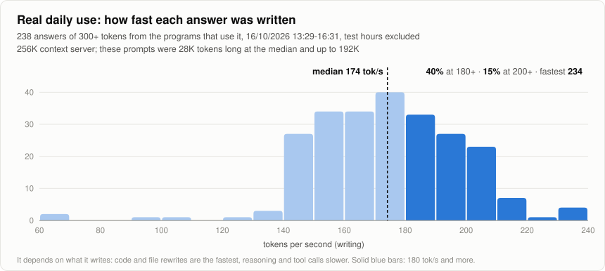
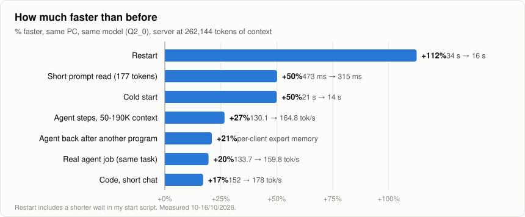

# Strata + Qwen3.8-Flash-Next on an RTX 5070 Ti 16 GB — my fork

*Alessandro Patassini, October 2026.* A fork of [Strata](https://github.com/Niko1221/Strata) (MIT) with the patches and
settings I use every day to run **Qwen3.8-Flash-Next (GSQ-RCO Q2_0, 256K context)** behind a coding agent, a mail/project
assistant and Codex. Work done with Claude (Anthropic) as the coding assistant.

**All the numbers on this page are mine, measured on my PC.** For Strata itself, its install and its own speed tables
see the [upstream README](https://github.com/Niko1221/Strata#readme).

> [!IMPORTANT]
> **Every number here is measured with the server at 256K context (262,144 tokens), the way I use it every day.**
> Many speed tests run with a small context (upstream's own table: 4K answers on 32K prompts). A big context costs
> speed: on this PC writing at 120-136K tokens of context is ~10-15% slower than under 11K. My agent's prompts are
> really long (50-190K tokens in the agent benchmark; in today's daily use 28K at the median and up to 192K), and these
> are the speeds it gets.

## My PC
RTX 5070 Ti 16 GB (the model only) + RTX 4060 Ti 8 GB (monitors and the vision encoder), Ryzen 9 7950X, 128 GB DDR5 at
3800 MT/s, Windows 11. Model: Qwen3.8-Flash-Next Q2_0, one profile of 262,144 tokens.

## How fast it runs here

<picture>
  <source media="(prefers-color-scheme: dark)" srcset="docs/qwen38/daily-use-dark.svg">
  
</picture>

<picture>
  <source media="(prefers-color-scheme: dark)" srcset="docs/qwen38/speedups-dark.svg">
  
</picture>

The numbers behind the charts:
| what | measured | when, how |
|---|---|---|
| **writes code, short chat** | **178 tok/s** (152 with the official engine 0.1.41 and default settings) | 12/10/2026, 0.1.43 + MTP draft head, before the router push |
| **agent steps** (24 real steps of my coding agent, 50-190K tokens of context, temperature 0.6) | **164.8 tok/s** (130.1 the same morning before the router push and the Q3_K kernel: **+27%**) | 14/10/2026 |
| **real daily use** (every answer of 300+ tokens from the programs that use it, test hours excluded) | median **174 tok/s**, 1 in 4 above **190**, 1 in 10 above **203**, fastest **234** (238 answers); it depends a lot on what it writes: code and file rewrites are the fastest | 16/10/2026 from 13:29, all the changes on, from my per-request log |
| **a real agent job** in the agent's window (same task, with and without the router push) | **159.8 vs 133.7 tok/s** (+19.5%) | 14/10/2026 |
| **reads a long prompt** | **203K tokens in 58.5 s** (~3,470 tok/s) | 0.1.43 |
| **reads short prompts** (what an agent reads most) | 177 tokens 315 ms (was 473), ~500 470 ms (was 668), ~900 677 ms (was 826); in real agent traffic -37/-41% | 16/10/2026 |
| **starts** | 14 s from cold (was 21), restart 16 s (was 34) | 16/10/2026 |
| an agent coming back after another program filled the cache | **+21%** tok/s | 10/10/2026, per-client expert memory |

The router push (`STRATA_ROUTE_PRIOR=1.0`) changes answers a little; I checked quality on two real tasks with hidden tests
(3 runs with, 3 without): no measurable loss.

## What is in this fork
- **[QWEN38.md](QWEN38.md)**: every setting and patch with its measurement, what did **not** help (so you don't have to try
  it), and how I trained my own MTP draft head (method only: the weights come from my own conversations).
- Branches, one improvement each on top of upstream 0.1.44.1, proposed upstream as pull requests:
  [`short-prompt-reads`](https://github.com/apatassini/Strata/tree/short-prompt-reads) ([#2774](https://github.com/Niko1221/Strata/pull/2774)),
  [`client-memory`](https://github.com/apatassini/Strata/tree/client-memory) ([#2775](https://github.com/Niko1221/Strata/pull/2775)),
  [`arena-load-threads`](https://github.com/apatassini/Strata/tree/arena-load-threads) ([#2776](https://github.com/Niko1221/Strata/pull/2776)),
  [`vision-parallel-start`](https://github.com/apatassini/Strata/tree/vision-parallel-start) ([#2777](https://github.com/Niko1221/Strata/pull/2777)).
- `qwen38-16gb` (this branch): everything I run, on top of 0.1.43.

Speeds depend a lot on the card, the RAM and the kind of text: these are one PC's numbers, not a promise.

License: MIT, as upstream.
